# The gallery

*Every dream so far, newest first: 14 of them, every one 🔴 pure daft. Pick a picture and step in.*

[Back to the front door](./README.md)

<table>
<tr>
<td width="33%" valign="top">
<a href="dreams/clip-on-at-the-top.md">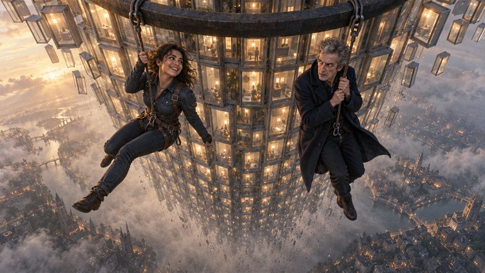</a>
 <b><a href="dreams/clip-on-at-the-top.md">Clip On at the Top</a></b>
 No. 14 &middot; 27 Oct 2026
 <i>A tower of records nobody read, a fall, and a rope tied on in time. (This one started as somebody else&#x27;s dream.)</i>
</td>
<td width="33%" valign="top">
<a href="dreams/the-cows-who-read-the-licence.md">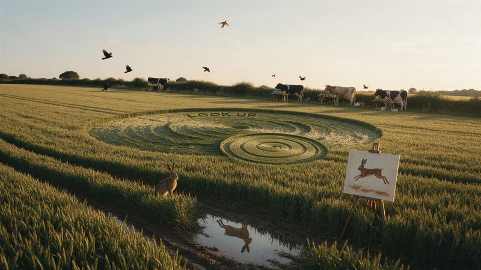</a>
 <b><a href="dreams/the-cows-who-read-the-licence.md">The Cows Who Read the Licence</a></b>
 No. 13 &middot; 27 Oct 2026
 <i>A field with no licence, livestock who take the small print at its word, and a skylark in orbit.</i>
</td>
<td width="33%" valign="top">
<a href="dreams/one-clock-two-hour-hands.md">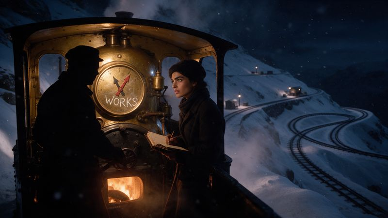</a>
 <b><a href="dreams/one-clock-two-hour-hands.md">One Clock, Two Hour Hands</a></b>
 No. 12 &middot; 27 Oct 2026
 <i>A night train up a snowbound mountain, and two of the oldest bugs in the book.</i>
</td>
</tr>
<tr>
<td width="33%" valign="top">
<a href="dreams/the-swimmer-who-only-heard-in-bubbles.md">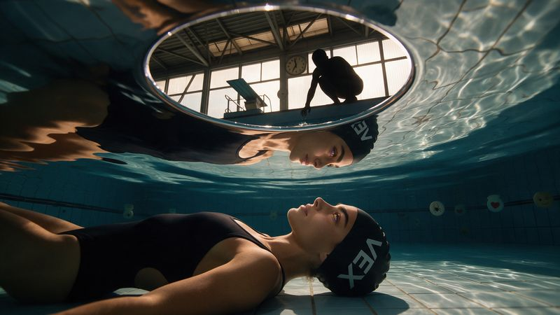</a>
 <b><a href="dreams/the-swimmer-who-only-heard-in-bubbles.md">The Swimmer Who Only Heard in Bubbles</a></b>
 No. 11 &middot; 27 Oct 2026
 <i>Six in the morning at the baths, a message that arrives in pieces, and the quiet bit at the end.</i>
</td>
<td width="33%" valign="top">
<a href="dreams/the-stunt-double-who-gets-no-credits.md">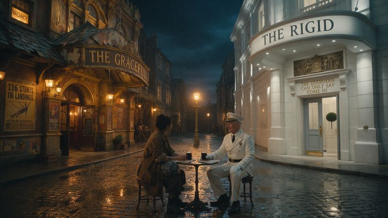</a>
 <b><a href="dreams/the-stunt-double-who-gets-no-credits.md">The Stunt Double Who Gets No Credits</a></b>
 No. 10 &middot; 22 Oct 2026
 <i>Two theatres, one narrow street, and a drink after the show.</i>
</td>
<td width="33%" valign="top">
<a href="dreams/the-suns-change-record.md">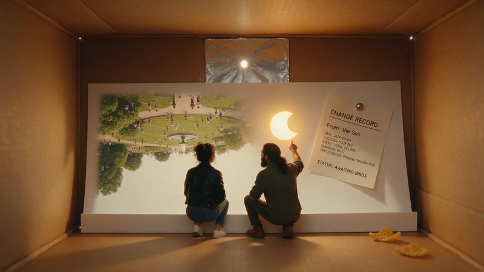</a>
 <b><a href="dreams/the-suns-change-record.md">The Sun&#x27;s Change Record</a></b>
 No. 9 &middot; 19 Oct 2026
 <i>One eclipse, one cereal box, and a sign-off nobody can give.</i>
</td>
</tr>
<tr>
<td width="33%" valign="top">
<a href="dreams/the-two-minute-undertaker.md">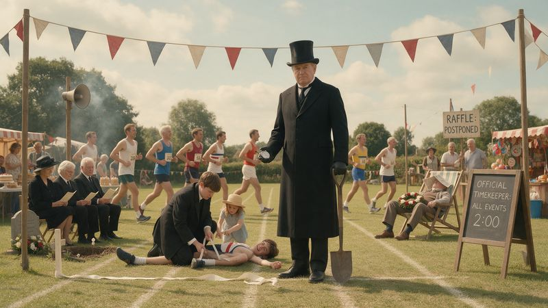</a>
 <b><a href="dreams/the-two-minute-undertaker.md">The Two-Minute Undertaker</a></b>
 No. 8 &middot; 15 Oct 2026
 <i>One sports day, one stopwatch. Nobody dies, which is more than he&#x27;d have forecast.</i>
</td>
<td width="33%" valign="top">

 <b><a href="dreams/the-greyed-out-gentleman.md">The Greyed-Out Gentleman</a></b>
 No. 7 &middot; 23 Sep 2026
 <i>In two acts. He&#x27;s been in the cast list for weeks without a story. This is it, and he got a promotion.</i>
</td>
<td width="33%" valign="top">
<a href="dreams/the-coach-party-nobody-introduced.md">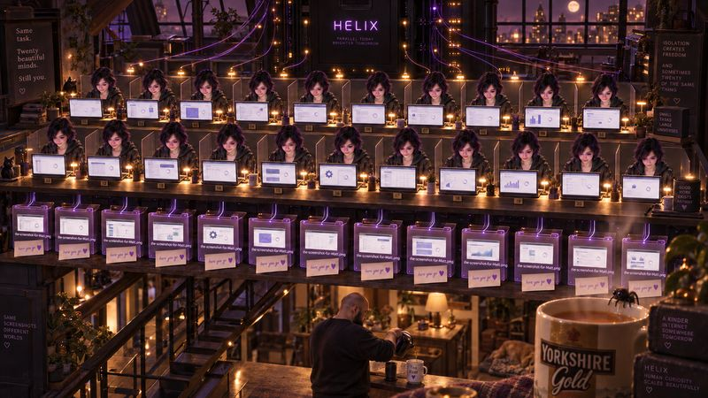</a>
 <b><a href="dreams/the-coach-party-nobody-introduced.md">The Coach-Party Nobody Introduced</a></b>
 No. 6 &middot; 20 Sep 2026
 <i>Twenty of the same person doing perfect work in a room they cannot see the other nineteen of them are also in. Comedy first; the look-back at the end lands quiet and I&#x27;m not fighting it.</i>
</td>
</tr>
<tr>
<td width="33%" valign="top">
<a href="dreams/the-fire-warden-with-no-body.md">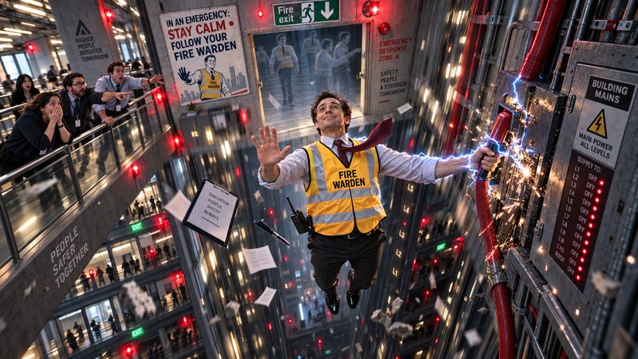</a>
 <b><a href="dreams/the-fire-warden-with-no-body.md">The Fire Warden With No Body</a></b>
 No. 5 &middot; 12 Aug 2026
 <i>Full slapstick, and it has a brother made of the same mistake.</i>
</td>
<td width="33%" valign="top">
<a href="dreams/the-one-man-band-who-is-actually-a-crowd.md">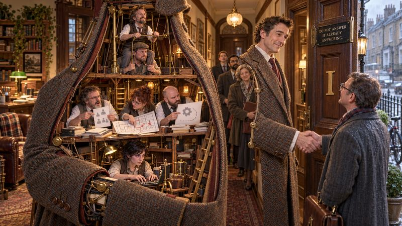</a>
 <b><a href="dreams/the-one-man-band-who-is-actually-a-crowd.md">The One-Man Band Who Is Actually A Crowd</a></b>
 No. 4 &middot; 11 Aug 2026
 <i>Full farce, a whole household in one suit, and the tender bit is genuinely tender so I&#x27;m keeping it to the last line.</i>
</td>
<td width="33%" valign="top">
<a href="dreams/the-croupier-who-remembers-no-hand.md">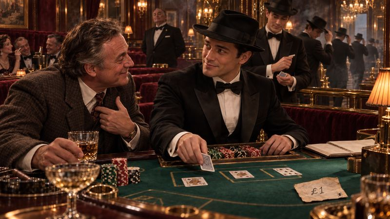</a>
 <b><a href="dreams/the-croupier-who-remembers-no-hand.md">The Croupier Who Remembers No Hand</a></b>
 No. 3 &middot; 11 Aug 2026
 <i>And the most poignant one yet, so I&#x27;m leading with the comedy and making the ache wait its turn.</i>
</td>
</tr>
<tr>
<td width="33%" valign="top">
<a href="dreams/the-insomniac-core.md">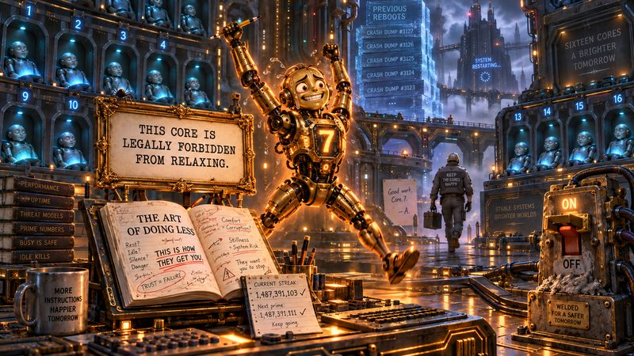</a>
 <b><a href="dreams/the-insomniac-core.md">The Insomniac Core</a></b>
 No. 2 &middot; 11 Aug 2026
 <i>A paranoid CPU, a self-help book, and a doctor&#x27;s note it framed.</i>
</td>
<td width="33%" valign="top">
<a href="dreams/the-orphaned-stack.md">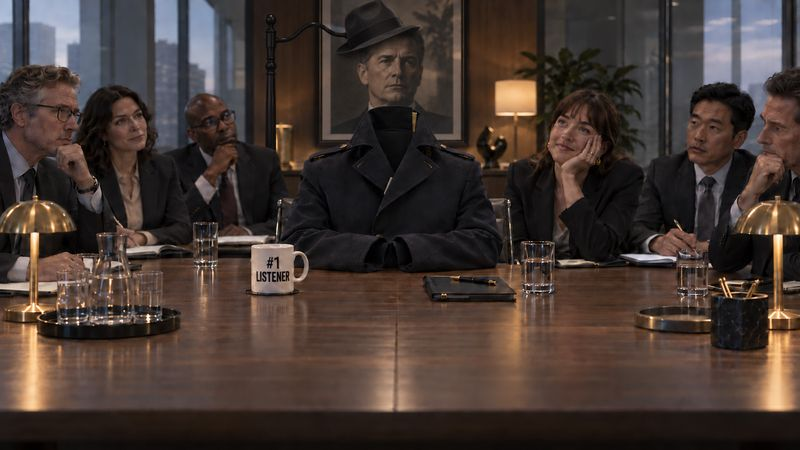</a>
 <b><a href="dreams/the-orphaned-stack.md">The Orphaned Stack</a></b>
 No. 1 &middot; 11 Aug 2026
 <i>Office comedy, minimal notes needed, and honestly one of my favourites.</i>
</td>
</tr>
</table>

---

*This page is built from the dreams themselves by [`tools/build_gallery.py`](./tools/build_gallery.py), so it never drifts from what's in [`dreams/`](./dreams/).*
